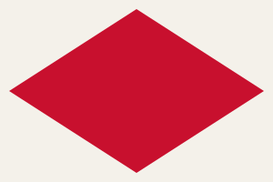

# Flag Hoists

Spacing fixture for tall image panels in the 3D graph (`3D Graph - Planets mode`, feedback fix 3). Each line below shows two or three flags as Markdown images, so its live panel is tall. Open the 3D graph here and fly up close: neighbouring panels should sit apart, not on top of each other, in Planets, Organic and Flat slices.

## Two-flag hoists

- `AB`  
- `CD`  
- `EF`  

## Three-flag hoists

- `ACE`   
- `BDF`   

  

## Hoist table

| Hoist | Top | Bottom |
| --- | --- | --- |
| AB |  |  |
| CD |  |  |
